# System Architecture — Agency

This document illustrates the end-to-end architecture, trust boundaries, multi-agent workflow, persistence, deployment adapters, and observability pipelines of **Agency**.

---

## 1. High-Level Architecture Diagram

```mermaid
flowchart TB
    subgraph UntrustedZone["Untrusted External Boundary"]
        Client["Client / External Source"]
        ClientBrief["Brief / Reference URLs"]
    end

    subgraph OperatorZone["Operator Trust Boundary"]
        Operator["Operator"]
        Dashboard["Next.js Dashboard\n(Port 3000)"]
    end

    subgraph CoreZone["Trusted Core Application Boundary"]
        API["FastAPI REST & SSE API\n(Port 8000)"]
        subgraph UseCases["Application Layer"]
            StartRunUC["StartRun UseCase"]
            GetRunUC["GetRun UseCase"]
            ApproveUC["ApproveRun / ReviseRun"]
            CancelUC["CancelRun UseCase"]
            WorkflowRunner["WorkflowRunner Supervisor"]
        end

        subgraph GraphEngine["LangGraph Execution Engine"]
            State["WorkflowState (Durable)"]
            IntakeNode["intake"]
            PMNode["pm_spec"]
            DesignerNode["designer"]
            ProtoNode["prototype"]
            ApprovalGate{{"Human Approval Gate\n(interrupt)"}}
            BuildNode["build"]
            QANode["qa"]
            RepairNode["repair"]
            GitPublishNode["github_publish"]
            PreviewNode["cloudflare_preview"]
            SmokeNode["smoke_tests"]
            ProdNode["cloudflare_production"]
            HandoverNode["handover"]
        end

        subgraph Persistence["Persistence & Checkpoints"]
            RunRepo[("Run Repository\n(SQLite / In-Memory)")]
            Checkpointer[("LangGraph Checkpoints\n(checkpoints.sqlite)")]
            EventBus["Broadcasting EventBus\n& Durable EventFeed"]
            ArtifactStore["LocalArtifactStorage\n(/artifacts)"]
        end
    end

    subgraph SandboxZone["Isolated Sandbox Boundary (network=none)"]
        DockerDaemon["Docker Daemon"]
        Sandbox["DockerSandbox Container\n(agency-sandbox:latest)\ncap_drop=ALL, unprivileged"]
        AstroBuild["Astro Build & Vite Bundle"]
        PlaywrightQA["Playwright Chromium QA"]
    end

    subgraph ExternalServices["External Infrastructure Adapters"]
        ModelRouter["ModelRouter / LLMPort"]
        Gemini["Google Gemini 1.5"]
        Ollama["Local Ollama"]
        FakeLLM["Deterministic FakeLLM"]

        GitPort["GitPort / GitHubAdapter"]
        DeployPort["DeployPort / CloudflarePagesAdapter"]
        GitHub["GitHub Workspaces API"]
        Cloudflare["Cloudflare Pages CDN"]
    end

    subgraph ObservabilityZone["Self-Hosted Observability Boundary"]
        TracingPort["TracingPort"]
        LangfuseServer["Langfuse Server\n(Port 3001)"]
        LangfuseWorker["Langfuse Worker"]
        LangfuseDB[("PostgreSQL 16")]
        LangfuseRedis[("Redis 7")]
        EvalRunner["Evaluation Runner\n(12 Brief Dataset)"]
    end

    %% Data Flow & Interactions
    ClientBrief -->|"Submit Brief"| Dashboard
    Operator -->|"Review Prototype & Approve"| Dashboard
    Dashboard -->|"HTTP POST / REST"| API
    API -->|"EventStream (SSE)"| Dashboard
    API --> UseCases
    UseCases -->|"Persist Run & Events"| RunRepo
    UseCases -->|"Publish Events"| EventBus
    UseCases -->|"Supervise Execution"| WorkflowRunner
    WorkflowRunner -->|"Execute Graph"| GraphEngine

    %% Graph Transitions
    IntakeNode --> PMNode --> DesignerNode --> ProtoNode --> ApprovalGate
    ApprovalGate -.->|"Wait For Decision"| Dashboard
    ApprovalGate -->|"Approved"| BuildNode
    ApprovalGate -->|"Revise"| PMNode
    BuildNode --> QANode
    QANode -->|"Pass"| GitPublishNode
    QANode -->|"Fail (retries < 3)"| RepairNode --> BuildNode
    GitPublishNode --> PreviewNode --> SmokeNode --> ProdNode --> HandoverNode

    %% Graph State Persistence
    GraphEngine <-->|"Checkpoint State"| Checkpointer

    %% Sandboxed Execution
    BuildNode & QANode -->|"Spawn & Exec"| DockerDaemon
    DockerDaemon --> Sandbox
    Sandbox --> AstroBuild & PlaywrightQA

    %% LLM Invocations
    PMNode & DesignerNode & BuildNode -.->|"Generate Models"| ModelRouter
    ModelRouter --> Gemini & Ollama & FakeLLM

    %% External Publishing
    GitPublishNode --> GitPort --> GitHub
    PreviewNode & ProdNode --> DeployPort --> Cloudflare

    %% Observability & Evaluations
    GraphEngine --> TracingPort
    TracingPort --> LangfuseServer
    LangfuseServer --> LangfuseDB & LangfuseRedis
    LangfuseWorker --> LangfuseDB & LangfuseRedis
    EvalRunner -->|"Automated Regression"| FakeLLM & BuildNode & QANode
```



---

## 2. Structural Layering and Clean Architecture

The architecture strictly adheres to Clean Architecture principles:

```text
+-------------------------------------------------------------------------+
| Interfaces (REST API, SSE Stream, CLI Commands, Dashboard UI)          |
|   +-------------------------------------------------------------------+ |
|   | Infrastructure (Docker, Langfuse, GitHub, Cloudflare, SQLite)      | |
|   |   +-------------------------------------------------------------+ | |
|   |   | Application (Use Cases, Graph Nodes, Ports, Supervisor)     | | |
|   |   |   +-------------------------------------------------------+ | | |
|   |   |   | Domain (Run State Machine, Brief, Events, Specs, SSRF) | | | |
|   |   |   +-------------------------------------------------------+ | | |
|   |   +-------------------------------------------------------------+ | |
|   +-------------------------------------------------------------------+ |
+-------------------------------------------------------------------------+
```

### Dependency Inversion Guarantee
- **Domain entities** (`Brief`, `Run`, `QAReport`) have zero external imports.
- **Application use cases** depend only on domain entities and abstract ports.
- **Infrastructure adapters** implement abstract ports (`SandboxPort`, `GitPort`, `DeployPort`, `TracingPort`).
- Changing persistence (e.g. SQLite to PostgreSQL) or LLM providers (e.g. Gemini to Anthropic) requires no modifications to domain or application graph logic.

---

## 3. Communication Patterns

1. **Synchronous Request/Response**:
   - Operator actions (creating runs, approvals, revisions, artifact downloads) execute via standard HTTP REST endpoints on port 8000.
   - All write operations require authorization via `X-API-Key` or `Authorization: Bearer <key>`.
2. **Asynchronous Real-Time Streaming**:
   - Workflow state changes and domain events stream to the Next.js dashboard over Server-Sent Events (`/api/v1/runs/{run_id}/events`).
   - Supports transparent reconnects via standard `Last-Event-ID` header.
3. **Background Multi-Agent Orchestration**:
   - `WorkflowRunner` supervises LangGraph execution in background threads.
   - Automatic pause at `RunState.AWAITING_APPROVAL` holds execution until explicit operator review.
4. **Isolated Build Sandboxes**:
   - Containers execute with `network_mode="none"`, dropped capabilities, unprivileged user `1000:1000`, and hard resource quotas.
5. **Observability & Distributed Tracing**:
   - Workflows emit spans and token metrics via `TracingPort` to self-hosted Langfuse on port 3001.
   - Logs are formatted as correlated single-line JSON on `stdout`.
